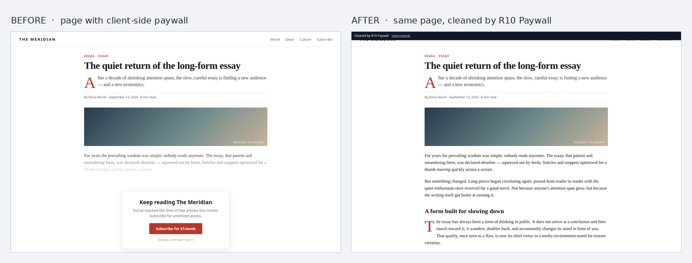
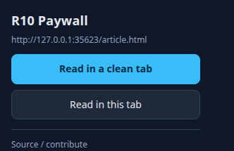

# R10 Paywall

A browser extension (Manifest V3) that reads paywalled articles by fetching the
raw HTML and stripping the **client-side** paywall — the same trick as running
`curl <url> > page.html` in the terminal and opening the file in a live server,
but with one click.

> **Disclaimer.** R10 Paywall is for personal use and research. It only reads
> content that the server already sends to your browser; it does not bypass
> login/authentication or decrypt DRM. Respect each site's Terms of Service and
> support the publications you value. MIT license — provided "as is".



<details>
<summary>Toolbar popup</summary>



</details>

_Screenshots use a fictional demo article; the popup and cleaned page are the real extension._

## How it works

Many sites are "soft-paywalled": the full article is present in the HTML, but a
client-side script hides it behind a modal, a blur, or a `display: none` after
you hit your free-article meter. When you `curl` the page (no cookies, no JS)
you get the full article. The extension reproduces that:

1. Fetches the page's raw HTML **without cookies** (like `curl`), so the server
   can't tell you've already hit the meter.
2. Removes scripts, overlays, cookie banners and hiding styles/attributes.
3. Rewrites relative URLs so images and styles still load.
4. Opens the cleaned page in a new tab (or rewrites the current tab).

## Install (unpacked)

1. Clone the repo and install dev dependencies (only needed for tests):
   ```bash
   git clone git@github.com:Douglas019BR/R10_paywall.git
   cd R10_paywall
   npm install
   ```
2. Open `chrome://extensions` (or `edge://extensions`).
3. Enable **Developer mode**.
4. Click **Load unpacked** and select the repo folder.

## Usage

1. Open a paywalled article.
2. Click the **R10 Paywall** icon in the toolbar.
3. Choose **Read in a clean tab** (recommended) or **Read in this tab**.

## Project structure

```
.
├── manifest.json          # MV3 manifest
├── src/
│   ├── background.js      # service worker: fetch + orchestrate
│   ├── offscreen.html     # offscreen document host (DOMParser lives here)
│   ├── offscreen.js       # parses + sanitizes the fetched HTML
│   ├── sanitize.js        # HTML sanitizer (DOM-based, browser-agnostic)
│   ├── rules.js           # loads rules/sites.json
│   └── popup.{html,css,js}# toolbar popup
├── rules/
│   └── sites.json         # per-site CSS selectors
├── test/
│   └── sanitize.test.js   # unit tests (node --test + jsdom)
├── tools/
│   └── gen_icons.py       # regenerates icons/
└── icons/
```

## Contributing

The generic sanitizer already handles the common cases, but each site hides its
content differently. The easiest way to help is adding a **site rule** in
[`rules/sites.json`](rules/sites.json):

```json
{
  "name": "Example News",
  "hostnames": ["*.example.com", "example.com"],
  "userAgent": "curl/8.0",
  "removeSelectors": [".paywall", "#subscription-overlay"],
  "keepSelectors": ["article", ".article-content"]
}
```

| Field             | Description                                                                    |
| ----------------- | ------------------------------------------------------------------------------ |
| `hostnames`       | Hostnames to match. `*.` matches subdomains (e.g. `*.example.com`).            |
| `userAgent`       | Optional. Spoof the `User-Agent` for this site. Some sites (e.g. Forbes) return 403 to a browser UA but serve the full article to a tool UA like `curl`. |
| `removeSelectors` | CSS selectors for elements to remove (paywall modals, overlays, gates).        |
| `keepSelectors`   | CSS selectors to protect — never removed, and their hiding styles are stripped.|

### How to find the right selectors

1. Open the article and right-click the paywall overlay → **Inspect**.
2. Note the `class`/`id` of the overlay (e.g. `.paywall-overlay`).
3. Note the container that holds the full article (e.g. `article` or `#content`).
4. Add both to `sites.json` and open a PR.

### Development

```bash
npm test              # run unit tests
python3 tools/gen_icons.py   # regenerate icons (requires Pillow)
```

After editing code or rules, click **Reload** on the extension card in
`chrome://extensions`.

## Roadmap

- [ ] Per-site referer spoofing and cookie handling (via `declarativeNetRequest`).
- [ ] Archive-based fallbacks (Google cache, archive.today) for hard paywalls.
- [ ] "Reader mode" view using Firefox's Readability.
- [ ] Firefox support (port to Manifest V2/V3 quirks).

## License

[MIT](LICENSE) © Douglas Sermarini
